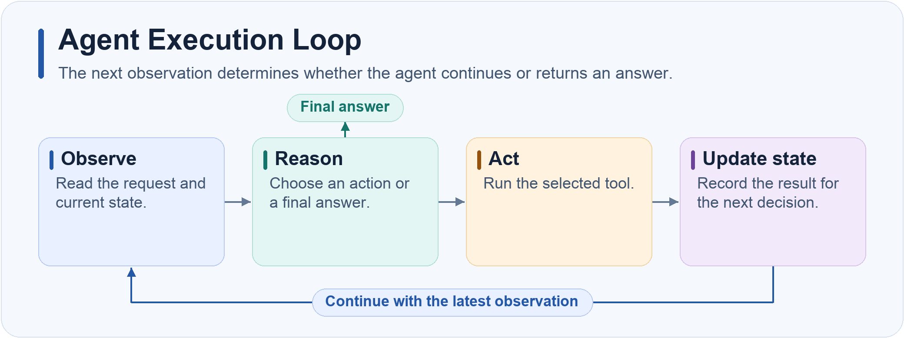

# AI agent và Agent Execution Loop

Mô-đun 01 · Bài 01 · Oracle Student Guide, trang 11–16 · [Mục lục](README.md)

Chatbot tiếp nhận câu hỏi và sinh câu trả lời. Workflow truyền thống thực thi các bước đã định trong mã. AI agent nhận một mục tiêu và chọn bước kế tiếp dựa trên yêu cầu, các công cụ được cấp và kết quả của những bước đã chạy. Cả ba có thể xuất hiện trong cùng một sản phẩm.

LLM xử lý ngôn ngữ và đề xuất bước tiếp theo. Khi được đặt trong một agent, đầu ra của mô hình có thể trở thành yêu cầu gọi tool. Ứng dụng thực thi lời gọi, đưa kết quả về cho mô hình, rồi lặp lại hoặc trả lời. Quy trình thường đi qua tiếp nhận đầu vào, quyết định, thực thi và quan sát kết quả.

**Ví dụ.** Khi tìm chuyến bay, agent có thể hỏi lại ngày khởi hành, tra lịch bay rồi so sánh kết quả. Nếu API trả về danh sách trống, bước sau có thể là hỏi người dùng có thể đổi ngày hay không. Một chatbot chỉ có kiến thức từ mô hình sẽ thiếu dữ liệu lịch bay tại thời điểm hỏi.

*Agent loop cập nhật state sau mỗi tool call. Đối chiếu Student Guide, trang 15–16.*

## Agent loop và state

Một LLM-based agent có bốn đặc điểm trong phạm vi bài này. Nó làm việc theo mục tiêu (**goal-directed**), tự chọn hành động trong phạm vi được cấu hình (**autonomy**), sử dụng **tools** và có thể lặp nhiều lượt. Tính tự chủ nằm ở việc chọn bước tiếp theo. Quyền đọc, ghi và thực hiện giao dịch vẫn do ứng dụng cấp.

Mỗi lượt có thể theo nhịp **observe → reason → act → observe**. Agent quan sát input và state hiện có, chọn hành động, nhận tool result rồi cập nhật state. Với ví dụ tìm chuyến bay, tra cứu giá là một hành động, còn chọn trả danh sách chuyến bay là điều kiện dừng của yêu cầu tra cứu. Đặt vé là một thao tác riêng có hệ quả nghiệp vụ.

Một lời gọi LLM đơn lẻ làm việc với prompt và dữ liệu đã đưa vào request. Agent runtime có thể giữ state qua nhiều request, tải thêm dữ liệu theo thời điểm và kiểm tra kết quả bằng tool.

**Tự kiểm tra.** Với yêu cầu xem trạng thái đơn hàng rồi đổi địa chỉ giao hàng, bước nào lấy dữ liệu và bước nào thay đổi dữ liệu?
