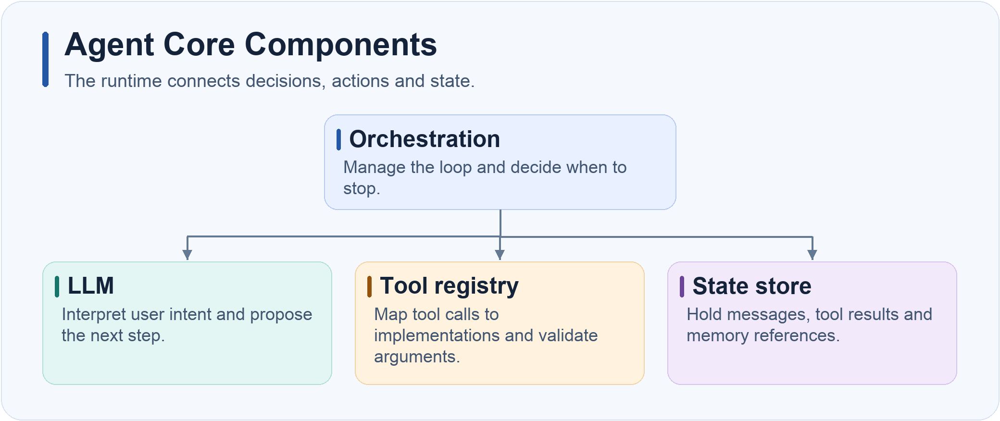

# Agent Core Components

Mô-đun 01 · Bài 02 · Oracle Student Guide, trang 17–21 · [Mục lục](README.md)

| Thành phần | Vai trò |
| --- | --- |
| LLM | Hiểu yêu cầu, chọn công cụ và đối số, diễn giải kết quả, soạn câu trả lời. |
| Tools | Thực thi các tác vụ như tính toán, gọi API, truy vấn dữ liệu hoặc truy xuất tài liệu cho RAG. |
| Orchestration | Cập nhật trạng thái, thực thi và kiểm tra lời gọi, xử lý lỗi, quyết định lặp, dừng hoặc chuyển cho người xử lý. |

Độ tin cậy khi sinh đối số đúng schema là một tiêu chí chọn mô hình. Số lần gọi mô hình trong vòng lặp ảnh hưởng trực tiếp đến độ trễ và chi phí. Với hệ thống có bước phân loại và bước giải quyết phức tạp, hai bước có thể dùng hai mô hình khác nhau.

Runtime có thể giữ lịch sử của lượt làm việc hiện tại và truy xuất dữ liệu lưu dài hạn khi cần. Cấu hình quyền và điều kiện dừng thuộc về ứng dụng. Chẳng hạn, nếu công cụ hết thời gian chờ, runtime có thể thử lại một thao tác đọc hoặc trả trạng thái lỗi để người dùng quyết định.

*Orchestration liên kết LLM, tool registry và state. Đối chiếu Student Guide, trang 18–21.*

## Chọn model và xác định trách nhiệm của runtime

Model cần tuân theo instructions, xử lý đủ context và sinh tool call khớp schema. Tác vụ phân loại có thể dùng model nhỏ, còn tác vụ cần đọc nhiều nguồn hoặc lập kế hoạch nhiều bước có thể dùng model có khả năng reasoning mạnh hơn. Hãy đo cả latency của lượt chạy vì cùng một yêu cầu có thể gọi model nhiều lần.

Một **tool registry** liên kết tên tool với phần triển khai thật. Tool có thể trả dữ liệu, chạy phép tính hoặc tạo side effect. Runtime giữ message history, kết quả đang chờ xử lý và giới hạn lượt chạy. **Short-term memory** phục vụ phiên hiện tại. **Long-term memory**, nếu được bật, lưu hoặc truy xuất dữ liệu qua nhiều phiên. State cũng cần ghi nhận lỗi để điều phối quyết định retry, quay lại bước trước hoặc yêu cầu người dùng làm rõ.

**Tự kiểm tra.** Trong log có yêu cầu gọi tool nhưng lời gọi gặp lỗi xác thực. Thành phần nào đưa ra yêu cầu và thành phần nào cần xử lý lỗi?
