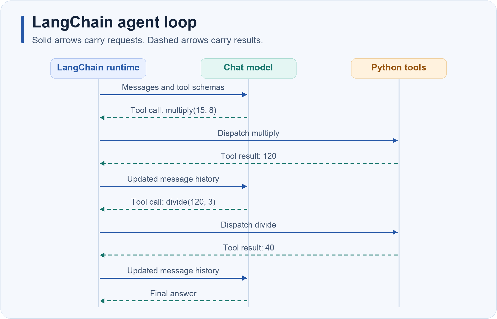

# LangChain agent loop từ request đến final output

Mô-đun 02 · Bài 03 · Oracle Student Guide, trang 73–88 · [Mục lục](README.md)

1. `agent.invoke` đặt câu hỏi vào trạng thái tin nhắn. LangChain gửi lịch sử và schema của các tool đến API mô hình.
2. Mô hình trả một tool call gồm tên, đối số và mã lời gọi. LangChain phân tích phản hồi, tra tool từ registry và gọi hàm thật.
3. Framework thêm tin nhắn kết quả gắn với mã lời gọi rồi gửi lại lịch sử. Nếu có phép tính tiếp theo, mô hình tạo tool call mới dựa trên kết quả vừa nhận.
4. Khi phản hồi chỉ còn nội dung trả lời, framework kết thúc và trả trạng thái về chương trình gọi.

Trong bài toán nhiều bước, có ba phản hồi từ mô hình khi lần lượt yêu cầu phép nhân, yêu cầu phép chia và kết luận. Số lần gọi mô hình có thể khác số lần chạy hàm. Khi điều tra lỗi, xem schema, đối số thực tế, kết quả tool và tin nhắn cuối. Vị trí đầu tiên chúng sai khác với mong đợi thường chỉ ra lớp cần sửa.

*LangChain runtime chuyển tool call thành lời gọi Python và cập nhật message history. Đối chiếu Student Guide, trang 74–88.*

## Đối chiếu các bước ở trang 74–85

| Trang | Dấu vết có thể kiểm tra |
| --- | --- |
| 74–75 | Python bắt đầu lượt chạy. Framework gửi user message cùng tool schemas đến model. |
| 76–79 | Model trả tool call đầu tiên. Framework đọc tên và đối số, tra registry rồi thực thi `multiply`. |
| 80–83 | Tool result được gắn vào history. Model chọn `divide` với kết quả vừa có, framework chạy và gửi tool result thứ hai. |
| 84–85 | Model trả final answer và caller lấy nội dung hiển thị. |

Interleaving giữa **assistant tool call** và **tool message** được giữ trong conversation state. Tool call ID liên kết mỗi kết quả với lời gọi tương ứng, đặc biệt hữu ích khi có nhiều lời gọi. Trang 86–88 phân vai giữa code của ứng dụng, framework và model. Đối chiếu ba lớp này trước khi sửa prompt, schema hoặc tool implementation.

**Thực hành.** In loại của từng tin nhắn trong `result["messages"]` và xác định tool call nào có kết quả được phép chia dùng lại.
