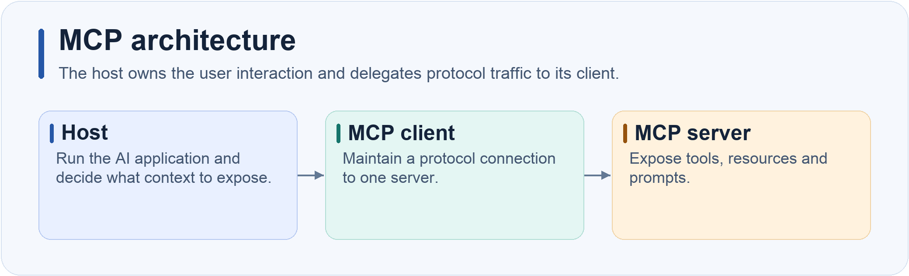

# Model Context Protocol là gì?

Mô-đun 03 · Bài 01 · Oracle Student Guide, trang 93–96 · [Mục lục](README.md)

Model Context Protocol (MCP) chuẩn hóa cách một ứng dụng AI khám phá và sử dụng công cụ, dữ liệu và prompt do hệ thống khác cung cấp. Nếu mỗi ứng dụng xây một adapter cho từng dịch vụ, số tích hợp có thể tăng theo tích của hai nhóm. Khi hai phía dùng cùng giao thức, một server có thể phục vụ nhiều kiểu ứng dụng và mỗi host tái sử dụng được các client.

- **Host** là ứng dụng người dùng tương tác. Nó điều phối mô hình, chính sách và quyền kết nối.
- **Client** duy trì kết nối giao thức tới một server. Host có thể tạo nhiều client.
- **Server** công bố năng lực hướng ra ngoài, ví dụ tra cứu catalog hoặc đọc tài liệu đã định phạm vi.

Mô hình nhận mô tả công cụ để đề xuất lời gọi. Host và client chịu trách nhiệm chuyển đề xuất đó thành yêu cầu MCP. Việc công bố một tool qua MCP vẫn cần đi kèm kiểm tra quyền ở nơi dữ liệu và hành động được thực thi.

*Một host có thể tạo nhiều MCP clients, mỗi client giữ kết nối với một server. Đối chiếu Student Guide, trang 94–96.*

## Integration cost và trust boundary

Nếu có ba host và bốn dịch vụ, mô hình tích hợp riêng từng cặp có thể đòi 12 adapter. Một protocol chung minh họa mô hình ba client integration cộng bốn server integration. Con số này mô tả việc triển khai giao thức. Mỗi hệ thống vẫn cần cấu hình kết nối, auth và policy phù hợp.

Host quyết định dữ liệu nào được cấp cho model và tool nào xuất hiện trong lượt chạy. Mỗi client quản lý phiên với một server và thực hiện protocol negotiation. MCP server quản lý implementation và giới hạn hành động trong hệ thống mà nó bọc. Ví dụ, server chi phí cloud có thể giới hạn quyền đọc tập báo cáo mà profile OCI được phép thấy.

**Tự kiểm tra.** Trong một ứng dụng có server tài liệu và server chi phí cloud, vẽ vị trí host, các client và các server.
