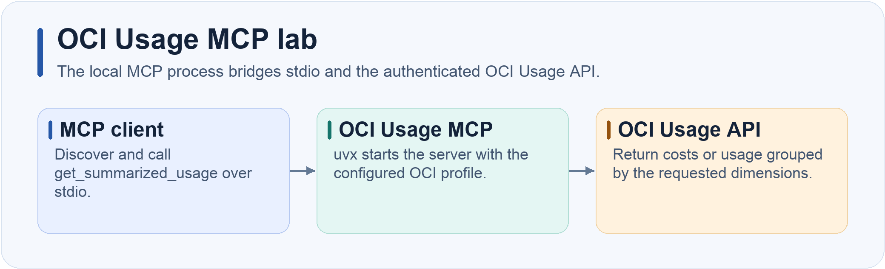

# Thực hành MCP với dữ liệu sử dụng OCI

Mô-đun 03 · Bài 04 · Oracle Student Guide, trang 116–120 · [Mục lục](README.md)

Oracle cung cấp gói `oracle.oci-usage-mcp-server`. Trong bài lab, `uvx` khởi chạy server trên máy cục bộ. Client trao đổi với server qua stdio. Chính tiến trình server gọi OCI Usage API qua HTTPS bằng hồ sơ OCI đã cấu hình.

Tool `get_summarized_usage` nhận tenancy, thời gian bắt đầu và kết thúc, độ chi tiết theo thời gian và chiều nhóm như dịch vụ. Loại truy vấn xác định dữ liệu chi phí hay mức sử dụng. Để tái tạo báo cáo, client cần áp dụng cùng bộ lọc và khoảng thời gian khi so sánh với Cost Analysis.

Có thể gọi server từ client trực tiếp để kiểm tra schema và dữ liệu trước khi thêm mô hình. Bài lab agent diễn giải yêu cầu ngôn ngữ tự nhiên thành tham số rồi tổng hợp kết quả. Workspace có hai báo cáo trên dữ liệu giả lập để đối chiếu. Truy vấn thật cần hồ sơ OCI có quyền đọc dữ liệu chi phí của tenancy.

*Client dùng stdio, còn OCI Usage MCP server gọi OCI Usage API qua HTTPS. Đối chiếu Student Guide, trang 117–120.*

## Đối chiếu từng chặng của bài thực hành

Math MCP server thực thi Python trên cùng máy. OCI Usage MCP server cũng có thể chạy cục bộ qua `uvx`, nhưng phần thực thi downstream dùng OCI SDK hoặc OCI Usage REST API. Client của hai bài đều dùng stdio và cùng cơ chế discovery/call. Sự khác biệt nằm ở backend, credentials và quyền của dữ liệu.

Bắt đầu từ kiểm tra OCI profile và tenancy. Sau khi mở `ClientSession`, gọi initialize, đọc danh sách tools và gọi `get_summarized_usage` với `tenant_id`, `start_time`, `end_time`, `granularity`, `group_by` và `query_type` theo schema trả về. Lab trực tiếp lấy bảy ngày gần nhất, dùng daily granularity, group by service và xuất bảng pivot cùng CSV. So sánh tổng và nhóm dịch vụ với **Cost Analysis** trong đúng khoảng báo cáo. Kiểm tra dữ liệu trực tiếp trước khi đọc phần diễn giải do model tạo.

`uvx` dùng môi trường tách biệt và có thể nạp package từ cache. Tham số OCI profile cần được truyền cho process server; agent host cũng cần biết tiến trình nào mang quyền truy vấn tenancy.

[Client OCI Usage](https://github.com/oracle-university-labs/ou-generativeai-pro/blob/085b7b13eeae897e3017ad110b703e2dcfd3a38c/agentic-ai-foundations/Real%20World%20MCP/01_oci_usage_mcp_client.py) · [Agent OCI Usage](https://github.com/oracle-university-labs/ou-generativeai-pro/blob/085b7b13eeae897e3017ad110b703e2dcfd3a38c/agentic-ai-foundations/Real%20World%20MCP/02_oci_usage_mcp_agent.py)

Trong workspace cục bộ, báo cáo mẫu nằm ở `results/oci-usage-agent-synthetic.csv`.
