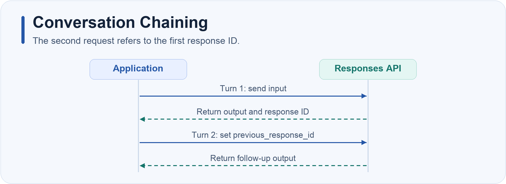

# Responses API, Conversation Chaining và Hosted Tools

Mô-đun 04 · Bài 02 · Oracle Student Guide, trang 130–135 · [Mục lục](README.md)

Ví dụ đầu tiên tạo client Python, gọi `client.responses.create` với `model` và `input`, rồi đọc `response.output_text`. Phản hồi cấu trúc còn có mã định danh và các phần tử đầu ra, tùy loại tác vụ. Giữ khóa API trong môi trường của chương trình chạy lab.

Để nối hai lượt, lưu `id` của phản hồi đầu và dùng `previous_response_id` khi gửi lượt hai. Ví dụ, lượt đầu lưu thông tin dự án mang tên Sao Mai. Lượt sau chỉ hỏi tên của dự án và dùng mã phản hồi làm điểm nối. Cấu hình chỉ dẫn cần thiết ở từng yêu cầu.

Thông qua tham số `tools`, bài học minh họa tìm kiếm web, tìm kiếm tài liệu, môi trường chạy mã, điều khiển giao diện và tạo ảnh. Mỗi công cụ có phạm vi và cấu hình riêng. Với tìm kiếm web, kiểm tra cả câu trả lời lẫn nguồn được trả về.

*Application dùng previous_response_id để nối request tiếp theo với response trước. Đối chiếu Student Guide, trang 131–135.*

## Input, output items và hosted tools

`input` có thể là chuỗi đơn giản hoặc danh sách input items có cấu trúc. `output_text` là cách đọc nhanh phần text. Khi debug, xem các output items để phân biệt final message, tool call và metadata. Conversation chaining bằng `previous_response_id` giữ mối liên hệ với phản hồi trước. Application cần lưu đúng ID theo phiên hoặc người dùng.

| Hosted tool trong guide | Vai trò trong flow |
| --- | --- |
| Web Search | Tìm dữ liệu theo thời điểm và trả nguồn để kiểm tra. |
| File Search | Tìm đoạn liên quan trong dữ liệu đã upload và lập chỉ mục. |
| Code Interpreter | Chạy Python trong môi trường cách ly để tính toán hoặc phân tích. |
| Computer Use | Đề xuất thao tác trên giao diện theo cấu hình của integration. |
| Image Generation | Tạo hình ảnh từ yêu cầu. |

Cho phép tool qua request tạo ra một lựa chọn cho model. Guide so sánh câu hỏi cần dữ liệu mới với câu hỏi kiến thức phổ thông để quan sát khi nào Web Search xuất hiện trong output.

[Gọi API lần đầu](https://github.com/oracle-university-labs/ou-generativeai-pro/blob/085b7b13eeae897e3017ad110b703e2dcfd3a38c/agentic-ai-foundations/OpenAI/01_hello_responses.py) · [Nối hội thoại](https://github.com/oracle-university-labs/ou-generativeai-pro/blob/085b7b13eeae897e3017ad110b703e2dcfd3a38c/agentic-ai-foundations/OpenAI/02_stateful_conversation.py) · [Tìm kiếm web](https://github.com/oracle-university-labs/ou-generativeai-pro/blob/085b7b13eeae897e3017ad110b703e2dcfd3a38c/agentic-ai-foundations/OpenAI/03_web_search.py)
