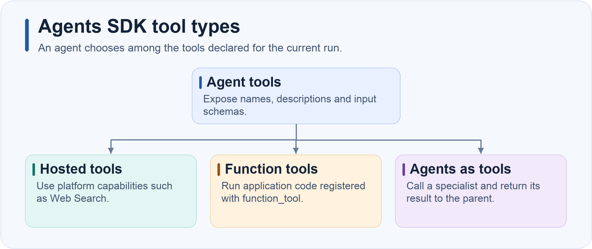

# Hosted Tools, Function Tools và Agents as Tools

Mô-đun 04 · Bài 04 · Oracle Student Guide, trang 142–148 · [Mục lục](README.md)

Agents SDK có hosted tools, công cụ từ hàm ứng dụng và agent được sử dụng như công cụ. Công cụ hosted phục vụ các tác vụ như tìm tài liệu hoặc tìm kiếm web. Nếu agent chính cần hỏi một chuyên gia rồi tự tổng hợp, có thể thêm agent chuyên gia bằng `as_tool`.

Dùng `@function_tool` cho hàm Python. Type hint và docstring cung cấp schema và mô tả cho mô hình. LLM sinh tên hàm và đối số, runner điều phối lời gọi, và hàm thực thi xử lý nghiệp vụ. Kiểm tra dữ liệu và quyền trong hàm trước khi đọc hoặc thay đổi dữ liệu thật.

Cùng ví dụ tính toán, bài LangChain đăng ký bằng `@tool` rồi gọi `agent.invoke`, còn Agents SDK dùng `@function_tool` và `Runner`. Trong cả hai trường hợp, kết quả của phép tính đầu có thể trở thành đầu vào của phép thứ hai.

*Agents SDK hỗ trợ hosted tools, function tools và agents as tools. Đối chiếu Student Guide, trang 142–148.*

## Function tool từ khai báo đến kết quả

Các **hosted tools** trong SDK được gắn vào agent, ví dụ `WebSearchTool` hoặc `FileSearchTool`. **Function tools** được đăng ký từ Python, còn **agents as tools** cung cấp một chuyên gia như một tool có tên và mô tả riêng.

Với `@function_tool`, SDK tạo input schema từ type hints, dùng docstring để mô tả mục đích và ánh xạ lời gọi về implementation. Trong bài toán nhiều bước, Runner chuyển kết quả phép nhân cho model, nhận yêu cầu chia rồi gửi tiếp kết quả phép chia trước khi model tạo final output. Hai tool calls thường đi kèm một lần gọi model nữa để tạo câu trả lời.

Guide dùng bốn phép `add`, `multiply`, `divide` và `square_root`. Khai báo phạm vi đầu vào và tạo lỗi rõ ràng cho mẫu số 0 và căn của số âm. Trace tách thời gian gọi model khỏi thời gian chạy hàm Python.

[Lab function tools](https://github.com/oracle-university-labs/ou-generativeai-pro/blob/085b7b13eeae897e3017ad110b703e2dcfd3a38c/agentic-ai-foundations/OpenAI/05_function_tools.py)
