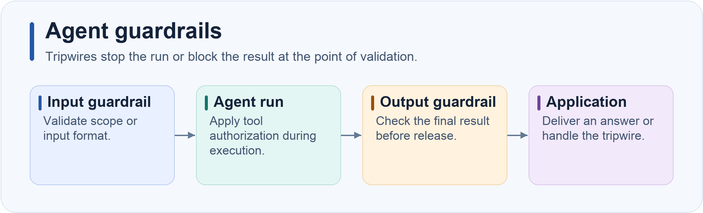

# Guardrails và tracing trong Agents SDK

Mô-đun 04 · Bài 06 · Oracle Student Guide, trang 153–156 · [Mục lục](README.md)

Input guardrail kiểm tra phạm vi yêu cầu và định dạng. Output guardrail kiểm tra kết quả trước khi trả cho người dùng. Với thao tác nhạy cảm, kiểm tra quyền ngay tại tool ghi dữ liệu, vì kiểm tra đầu ra xảy ra sau khi tác vụ đã chạy. Input guardrail có thể chặn trước agent chính hoặc chạy song song tùy cấu hình.

Bài lab dùng agent kiểm tra nhỏ với kiểu dữ liệu Pydantic có trường Boolean. Hàm gắn `@input_guardrail` gọi agent kiểm tra, rồi trả `GuardrailFunctionOutput` với cờ `tripwire_triggered` nếu yêu cầu nằm ngoài phạm vi. Ứng dụng xử lý trường hợp tripwire để báo rõ loại câu hỏi được hỗ trợ.

Trace hiển thị các lần gọi mô hình, tool, handoff và kiểm tra, giúp tìm lỗi định tuyến hoặc bước gây chậm. Khi ghi trace, che tham số nhạy cảm và nội dung cần giới hạn truy cập.

*Luồng minh họa input guardrail ở chế độ chặn trước khi agent chạy. Đối chiếu Student Guide, trang 153–156.*

## Guardrail result, tripwire và trace spans

Bài lab tạo model kiểm tra chủ đề với một trường Boolean. Hàm guardrail đọc kết quả này để đặt tripwire. Một kiểm tra deterministic theo schema phù hợp với yêu cầu như định dạng ID. Một checker agent có thể hỗ trợ phân loại chủ đề. Test cả trường hợp pass và reject để kiểm tra phản hồi của ứng dụng.

- **Input guardrail** có thể chặn trước lượt chạy hoặc chạy song song, tùy cấu hình. Tool có side effect cần chờ kiểm tra quyền tại thời điểm thực thi.
- **Output guardrail** có thể kiểm tra format, sự phù hợp, dữ liệu nhạy cảm và điều kiện trả kết quả.
- **Tracing** cho thấy thứ tự agent calls, tool arguments, handoff, guardrail result, latency và token usage trong phạm vi được ghi nhận.

Khi trace được bật, dùng span của checker và span của agent chính để xác định lỗi nằm ở phân loại, tool hay output. Giảm dữ liệu nhạy cảm được lưu trong trace theo chính sách của ứng dụng.

[Lab guardrails](https://github.com/oracle-university-labs/ou-generativeai-pro/blob/085b7b13eeae897e3017ad110b703e2dcfd3a38c/agentic-ai-foundations/OpenAI/07_guardrails.py)
