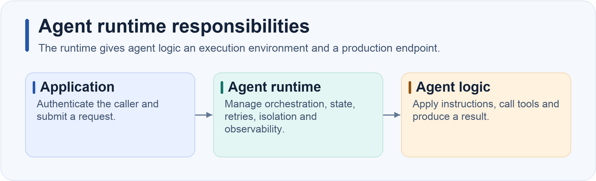

# Agent Lifecycle và Runtime Architecture

Mô-đun 05 · Bài 01 · Oracle Student Guide, trang 165–171 · [Mục lục](README.md)

Framework mô tả cách agent hoạt động. Để chạy được cho người dùng thật, ứng dụng cần môi trường thực thi và quy trình thay đổi phiên bản. Vòng đời gồm xây dựng, thử, triển khai, vận hành và cập nhật. Runtime tiếp nhận yêu cầu, duy trì trạng thái và cấp tài nguyên trong mỗi lượt chạy.

| Phần của runtime | Trách nhiệm |
| --- | --- |
| Điểm tiếp nhận | Xác thực, giới hạn tần suất và điều hướng yêu cầu. |
| Môi trường chạy | Cung cấp tiến trình, container và tài nguyên. |
| Điều phối và trạng thái | Quản lý các bước, phiên, retry và điều kiện dừng. |
| Cách ly công cụ | Hạn chế quyền, thời gian và tài nguyên cho hành động. |
| Tích hợp | Kết nối dịch vụ, cơ sở dữ liệu và quản lý xác thực. |
| Độ tin cậy | Cân bằng tải, mở rộng, xử lý thành phần bị lỗi. |
| Theo dõi | Thu thập log, metric và trace của từng lượt chạy. |

*Agent runtime nằm giữa application và agent logic. Đối chiếu Student Guide, trang 165–171.*

## Self-managed và managed runtime

Ba lớp của hệ thống gồm **user/application**, **runtime** và **agent logic**. Agent code có thể giữ nguyên khi đổi cách triển khai. Phần runtime cần quyết định tiếp nhận kết nối ở đâu, lưu state thế nào, dùng credentials nào cho integration và theo dõi lỗi thế nào khi lưu lượng tăng.

Với **self-managed runtime**, đội phát triển tự chọn VM, container hoặc serverless, cấu hình API gateway, state store, retry, monitoring và failover. Với **managed runtime**, một phần trách nhiệm này do nền tảng đảm nhiệm theo hình thức triển khai. Khi so sánh hai cách, kiểm tra cụ thể phần nào nền tảng chịu trách nhiệm và phần nào còn nằm trong application.

**Tự kiểm tra.** Với agent đã chạy trên laptop, liệt kê nơi nào lưu phiên và điều gì xảy ra khi tiến trình bị khởi động lại giữa hai bước gọi tool.
