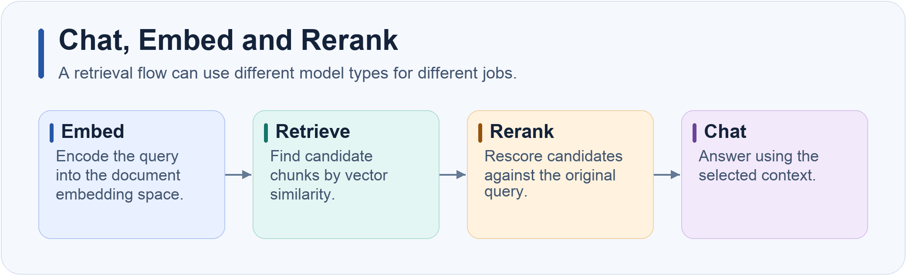

# Nền tảng OCI Enterprise AI

Mô-đun 05 · Bài 02 · Oracle Student Guide, trang 172–177 · [Mục lục](README.md)

Tài liệu chia nền tảng thành **Models** cho truy cập mô hình, **Agents** cho điều phối và thực thi, và **Governance** cho kiểm soát hành vi, mạng và danh tính.

- **Chat model** xử lý đầu vào và tạo phản hồi. **Embedding model** chuyển dữ liệu thành vector. **Rerank model** chấm lại các ứng viên sau truy xuất để ưu tiên kết quả liên quan hơn.
- **On-demand** dùng hạ tầng dùng chung và phù hợp với tải thay đổi. **Dedicated AI Cluster** cấp hạ tầng riêng, phù hợp khi cần cách ly, độ trễ ổn định hoặc có yêu cầu hosting riêng của mô hình. Chi phí và khả năng dùng tùy cấu hình dịch vụ.
- **Governance** áp dụng kiểm soát theo các lớp. Private Endpoint và Zero Trust Packet Routing (ZPR) phục vụ ranh giới mạng. IAM xác định ai được dùng hoặc quản lý tài nguyên. Guardrails kiểm tra các vấn đề như nội dung vi phạm, prompt injection và dữ liệu cá nhân.

*Trong flow RAG, Embed hỗ trợ retrieval, Rerank sắp xếp ứng viên rồi Chat dùng context để trả lời. Đối chiếu Student Guide, trang 173–175.*

## Serving modes và governance trong guide

| Tiêu chí | On-demand | Dedicated AI Cluster |
| --- | --- | --- |
| Capacity | Shared GPU. Throttling có thể thay đổi theo tải. | GPU dành riêng cho tenancy. |
| Chi phí | Theo mức sử dụng inference. | Theo thời gian cấp cluster. |
| Workload | Thử nghiệm, PoC và lưu lượng thay đổi. | Workload cần isolation, latency ổn định hoặc hosting custom model theo điều kiện dịch vụ. |

Guide dùng **exponential backoff** để minh họa xử lý throttling. Khi tính chi phí, đưa cả mức sử dụng cao liên tục và thời gian cấp cluster vào cùng phép so sánh. Với production SLA, xét latency thực tế, capacity và kế hoạch đổi model khi phiên bản cũ được retire.

**Governance** trong bài có ba lớp. **Network security** quy định đường mạng đến endpoint. **Identity control** dùng IAM policies theo tenancy hoặc compartment. **AI behavior controls** gồm content moderation, prompt injection defense và PII detection.

**Tự kiểm tra.** Trong ứng dụng hỏi đáp tài liệu, xác định vai trò của embedding khi tìm ứng viên và của reranker trước khi gọi chat model.
