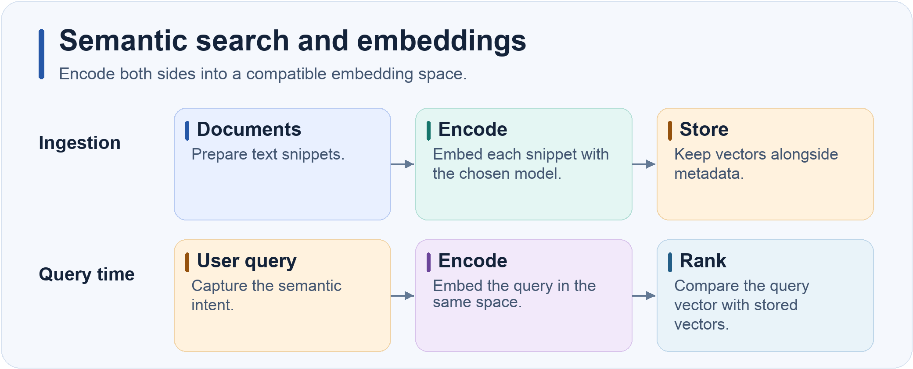

# Cơ bản về Oracle AI Vector Search

Mô-đun 06 · Bài 02 · Oracle Student Guide, trang 201–205 · [Mục lục](README.md)

Tìm kiếm từ khóa phụ thuộc từ xuất hiện trong văn bản. Semantic search biểu diễn văn bản và truy vấn thành các mảng số gọi là **embedding**, rồi dùng khoảng cách để xếp hạng. Hai câu diễn đạt khác nhau có thể có vector gần nhau nếu mô hình học được quan hệ về nghĩa.

Tokenizer tách văn bản thành token. Mô hình embedding xử lý chuỗi token và tạo vector với số chiều xác định. Số chiều và cách tạo vector phụ thuộc mô hình. Tài liệu và truy vấn cần được đưa vào cùng một không gian embedding để khoảng cách có ý nghĩa.

Oracle AI Database lưu vector cùng các cột thông thường. `VECTOR_DISTANCE` dùng trong SQL để xếp hạng theo độ gần, còn `WHERE` giới hạn theo giá, danh mục hoặc siêu dữ liệu khác. Kết quả semantic search có thể trở thành đoạn ngữ cảnh trong RAG.

*Corpus và query được encode vào cùng embedding space để xếp hạng. Đối chiếu Student Guide, trang 202–205.*

## Tokenization, embedding space và SQL-native retrieval

Một **vector** là dãy số có thứ tự. Một **embedding** là vector do model tạo để biểu diễn một input. Tokenizer có thể tách một từ thành nhiều **subword tokens**. Model xử lý các token trước khi tạo vector có số chiều cố định cho mỗi input. Cùng một chiều dài vector vẫn có thể là hai không gian embedding khác nhau.

Keyword matching vẫn hữu ích với ID, cụm từ chính xác hoặc tên riêng. Semantic search có thể đưa lên cao các kết quả dùng từ khác nhưng cùng nghĩa. Khi dùng cả hai, giữ đúng mục tiêu của từng phương pháp. Có thể kết hợp semantic ranking với relational predicates trong cùng câu SQL, ví dụ tìm mặt hàng gần ý định người dùng trong danh mục cụ thể.

**Tự kiểm tra.** Với yêu cầu tìm áo khoác đi mưa dưới một mức giá, xác định phần nào biểu diễn thành embedding và phần nào dùng điều kiện số.
