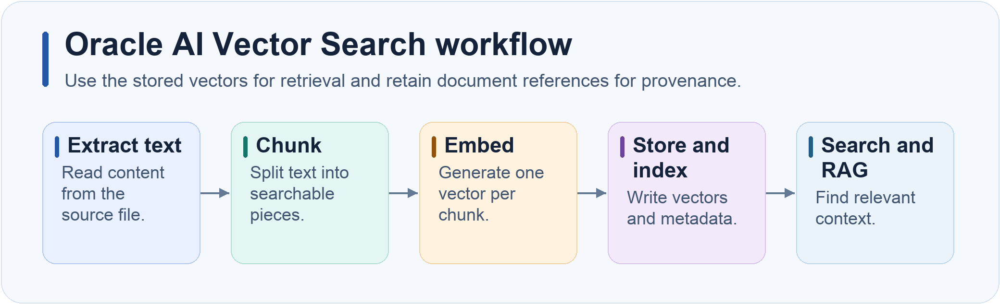

# Vector Search Workflow, Embeddings và Distance Metrics

Mô-đun 06 · Bài 03 · Oracle Student Guide, trang 206–211 · [Mục lục](README.md)

1. Trích văn bản và chia tài liệu dài thành các đoạn. Các tiện ích Oracle được giới thiệu gồm `UTL_TO_TEXT`, `UTL_TO_CHUNKS` và `UTL_TO_EMBEDDINGS`.
2. Tạo embedding bằng mô hình ONNX trong cơ sở dữ liệu hoặc dùng mô hình bên ngoài. Dùng cùng mô hình hoặc cấu hình cặp tài liệu và truy vấn phù hợp với mô hình đó.
3. Lưu vector cùng mã tài liệu, nội dung đoạn và siêu dữ liệu. Cột `VECTOR` có thể chỉ định số chiều, định dạng và cách lưu dense hoặc sparse.
4. Tính khoảng cách để tìm top-k. Với dữ liệu lớn, cân nhắc chỉ mục HNSW hoặc IVF cho truy vấn xấp xỉ. Workshop cũng đề cập chỉ mục hybrid khi kết hợp nhiều kiểu tìm kiếm.
5. Dùng các đoạn tìm được làm ngữ cảnh cho câu trả lời hoặc trả trực tiếp làm kết quả tìm kiếm.

Cosine đo độ khác hướng, Euclidean đo khoảng cách đường thẳng, Manhattan cộng chênh lệch tuyệt đối theo chiều, và dot product phụ thuộc cả độ lớn lẫn hướng. Chọn thước đo theo hướng dẫn của mô hình và giữ nhất quán giữa truy vấn và chỉ mục.

*Ingestion tạo text chunks và embeddings, rồi retrieval có thể cấp context cho RAG. Đối chiếu Student Guide, trang 206–211.*

## In-database và external embeddings

Bài học đưa hai hướng tạo embeddings. Mô hình ONNX có thể được nạp bằng `DBMS_VECTOR.LOAD_ONNX_MODEL` rồi gọi qua `VECTOR_EMBEDDING`. Hướng external dùng provider bên ngoài, SDK hoặc tiện ích `DBMS_VECTOR_CHAIN` với cấu hình provider/model. Với tài liệu dài, chuỗi text extraction, chunking và embedding có thể kết hợp trong pipeline ingest. Mỗi chunk cần giữ document ID và vị trí để truy ngược nguồn.

Kiểu cột `VECTOR` có thể khai báo cố định như `VECTOR(384, FLOAT32)`. Các ví dụ trong guide đề cập `FLOAT32`, `FLOAT64`, `INT8` và `BINARY`, cùng dense/sparse representation. Khi xếp hạng, `VECTOR_DISTANCE` nhận metric như `COSINE` hoặc `EUCLIDEAN`; guide còn minh họa `COSINE_DISTANCE`, `L2_DISTANCE`, `L1_DISTANCE` và `INNER_PRODUCT`. Với inner product, điểm lớn thường biểu thị phù hợp hơn, còn khoảng cách nhỏ hơn thường biểu thị gần hơn.

**Exact search** cho baseline trực tiếp. **Approximate nearest neighbor** dùng index như HNSW hoặc IVF để đổi giữa latency và recall. Dùng baseline để đánh giá chất lượng trước khi bật index trên tập dữ liệu lớn.

**Tự kiểm tra.** Khi đổi sang mô hình embedding có số chiều khác, xác định phần nào của pipeline cần tạo lại.
