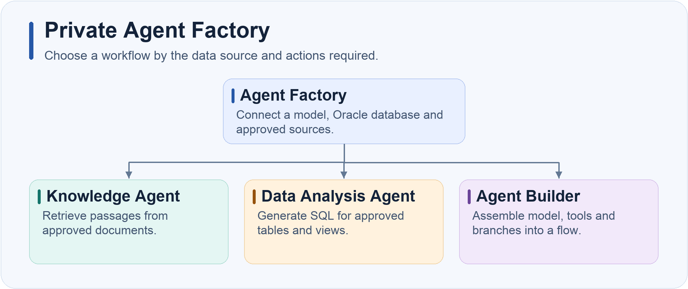

# Xây agent bằng Private Agent Factory

Mô-đun 06 · Bài 05 · Oracle Student Guide, trang 223–228 · [Mục lục](README.md)

Private Agent Factory là công cụ trực quan để kết nối mô hình, nguồn dữ liệu và luồng agent. Tài liệu mô tả kiến trúc triển khai bằng container, kết nối Oracle AI Database và một nhà cung cấp mô hình đã cấu hình.

- **Knowledge Agent** phục vụ hỏi đáp trên tài liệu được duyệt. Nội dung có thể đến từ tệp, website hoặc kho lưu trữ. Vector Search tìm đoạn liên quan và câu trả lời có thể kèm liên kết nguồn.
- **Data Analysis Agent** phục vụ dữ liệu có cấu trúc. Nó chuyển câu hỏi thành SQL dựa trên các bảng hoặc view có thể truy cập và có thể hiển thị biểu đồ.
- **Agent Builder** dùng các nút trực quan để phối hợp bước gọi mô hình, tool, nhánh điều kiện và agent chuyên trách. Các bước mở rộng có thể gồm thành phần Python và công cụ MCP.

*Private Agent Factory phân biệt document retrieval, data analysis và custom workflow. Đối chiếu Student Guide, trang 224–228.*

## Request flow và ba cách xây agent

Guide mô tả **Business User → Agent Factory → LLM provider và Oracle Database**. Tùy workflow, Agent Factory có thể lấy tài liệu, chạy query hoặc gọi tool rồi đưa kết quả về model. Tài liệu minh họa chạy Agent Factory bằng container với Podman và kết nối đến Oracle AI Database 26ai.

| Thành phần | Các bước minh họa |
| --- | --- |
| Knowledge Agent | Kết nối nguồn như SharePoint, file, website hoặc OCI Object Storage, lập chỉ mục vector, truy xuất đoạn phù hợp và dẫn nguồn khi trả lời. |
| Data Analysis Agent | Xác định table/view được phép, hiểu schema, tạo và chạy SQL, hiển thị kết quả hoặc biểu đồ, gợi ý câu hỏi tiếp theo theo dữ liệu. |
| Agent Builder | Ghép các nodes trực quan cho LLM, tools và workflow. Có thể nối MCP server, thêm Python components hoặc điều phối nhiều agents. |

Guide phân biệt database dùng để chạy Agent Factory và database nguồn dùng cho Data Analysis Agent. Khi đọc yêu cầu phiên bản ở trang 225–227, đối chiếu đúng vai trò của từng kết nối.

**Tự kiểm tra.** Phân loại hai yêu cầu đọc quy trình nghỉ phép và tính tổng số ngày nghỉ theo tháng. Xác định tài liệu hoặc bảng nào cần cấp quyền cho từng yêu cầu.
