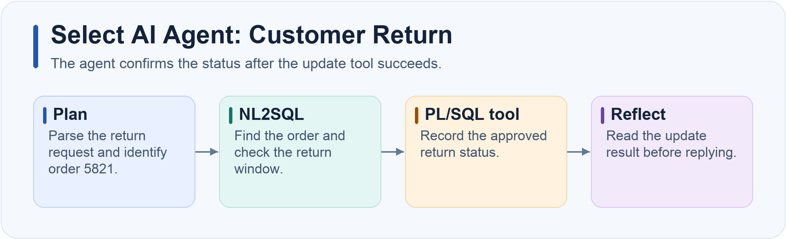

# Select AI Agent và Customer Return Workflow

Mô-đun 06 · Bài 06 · Oracle Student Guide, trang 229–234 · [Mục lục](README.md)

Select AI Agent điều phối agent trong Oracle AI Database. AI profile cung cấp cấu hình mô hình và ngữ cảnh cho tác vụ. Các API như `DBMS_CLOUD_AI_AGENT` định nghĩa agent, tool, task và team. Workflow phân tích yêu cầu, dùng tool, đánh giá kết quả rồi lưu ngữ cảnh cần cho các lượt sau.

Công cụ có thể dùng RAG để truy xuất tài liệu, NL2SQL để tra cứu đối tượng đã duyệt, PL/SQL để thực hiện nghiệp vụ hoặc REST để tích hợp dịch vụ ngoài. Thao tác trên dữ liệu chịu quyền và kiểm toán của cơ sở dữ liệu.

Trong bài trả hàng, tool đọc đơn, workflow kiểm tra điều kiện trong cửa sổ 30 ngày, rồi PL/SQL cập nhật trạng thái khi đạt yêu cầu. Agent chỉ nên xác nhận đã duyệt sau khi tool xác nhận cập nhật thành công. Một bước gửi thông báo cần có công cụ và bằng chứng thực thi riêng.

Trong workspace cục bộ, bài mô phỏng nằm ở `customer_return_local.py` và kết quả kiểm tra ở `results/customer-return-local.json`.

*Customer Return Agent đọc dữ liệu, kiểm tra chính sách, cập nhật trạng thái rồi xác nhận. Đối chiếu Student Guide, trang 230–234.*

## AI profile, tool types và workflow trả hàng

| Lớp | Công việc trong một lượt chạy |
| --- | --- |
| Planning | Đọc request, context phiên và kết quả trước đó để chọn thứ tự thao tác. |
| Tool use | Chạy built-in RAG/NL2SQL, custom PL/SQL hoặc integration REST tùy mục tiêu. |
| Reflection | So kết quả với mục tiêu, điều chỉnh plan hoặc hỏi thêm nếu còn thiếu dữ liệu. |
| Memory management | Giữ session context và thông tin dài hạn theo cấu hình của agent team. |

Với `DBMS_CLOUD_AI_AGENT.CREATE_AGENT`, thuộc tính như `profile_name` trỏ đến AI profile và `role` mô tả nhiệm vụ. Agent, tools và tasks được kết hợp trong team. Ví dụ trang 234 dùng order 5821. Tool NL2SQL tìm đơn, workflow kiểm tra trong 30 ngày, rồi custom tool `Update_Order_Status_Tool` cập nhật thành `Return Approved`. Kết quả cập nhật là căn cứ để agent xác nhận bước này.

Đặt business validation, RBAC và audit trong ranh giới database. Việc thông báo qua email hoặc một dịch vụ REST là side effect riêng, cần input rõ và kết quả được xác nhận.
