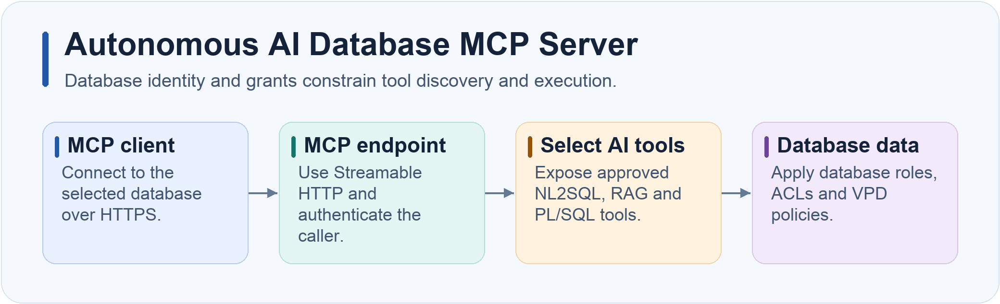

# MCP server tích hợp trong Autonomous AI Database

Mô-đun 06 · Bài 07 · Oracle Student Guide, trang 235–240 · [Mục lục](README.md)

Bài học mô tả MCP server do Oracle vận hành trong Autonomous AI Database Serverless. MCP client kết nối qua HTTPS bằng Streamable HTTP. Endpoint gắn với một database, và server công bố các tool đăng ký qua Select AI Agent như NL2SQL, RAG hoặc PL/SQL tùy biến.

Luồng yêu cầu đi từ MCP client đến endpoint, sau đó đến tool được cấp quyền trong cơ sở dữ liệu. AI profile đã cấu hình ngữ cảnh schema có thể giảm các bước khám phá bảng và cột khi chuyển ngôn ngữ tự nhiên thành SQL. Quyền của tài khoản cơ sở dữ liệu, ACL, VPD và kiểm toán tiếp tục áp dụng theo cấu hình.

*MCP endpoint công bố Select AI tools theo quyền của database identity. Đối chiếu Student Guide, trang 236–240.*

## Endpoint, AI profile và quyền trên từng database

Guide mô tả endpoint MCP được chọn theo **region** và **database OCID**. Khi bật tính năng cho một Autonomous AI Database bằng cấu hình được mô tả trong guide, MCP client kết nối tới HTTPS endpoint của database đó. Oracle vận hành server, còn database credentials và grants xác định caller được khám phá hoặc gọi tool nào. Guide nêu vai trò của **role-based access control (RBAC)**, **access control lists (ACLs)** và **Virtual Private Database (VPD)**.

Một **database-native MCP server** thực thi tools đã định nghĩa qua Select AI Agent. Với NL2SQL, schema metadata trong AI profile có thể rút bớt các lượt introspection. Với RAG và custom PL/SQL, điều quan trọng vẫn là giới hạn dữ liệu và hành động cho tài khoản gọi. Đọc trang 239–240 để đối chiếu luồng từ MCP client, qua endpoint, đến từng loại tool và database identity.

**Tự kiểm tra.** Với hai người dùng có quyền xem các khu vực bán hàng khác nhau, xác định điều gì cần kiểm tra ở bước khám phá tool và ở kết quả truy vấn. Vẽ đường đi từ client đến công cụ truy vấn và đánh dấu nơi xác thực tài khoản.
