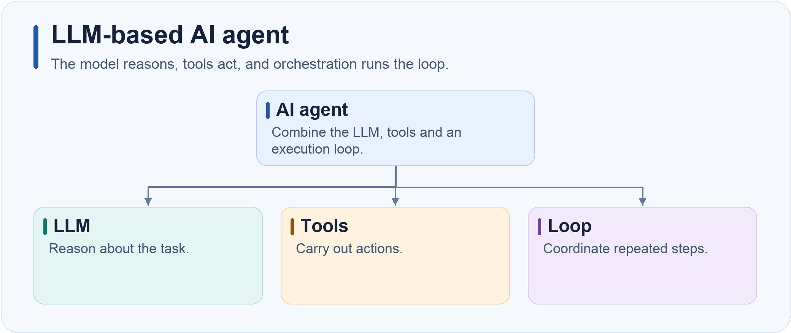

# Introduction to AI Agents

Student Guide · What You’ve Learned · trang 53 · [Mục lục](README.md)

1. `AI Agent (LLM-based) = LLM + Tools + Loop`.
2. **LLM** là thành phần reasoning. Chọn model là bài toán cân bằng các đánh đổi.
3. **Tools** mở rộng khả năng tạo văn bản của LLM sang thực thi hành động.
4. **Loop (orchestration)** điều phối toàn bộ hoạt động, tương tự hệ điều hành của agent.
5. **ReAct (Reasoning & Acting)** kết hợp Chain-of-Thought và tool use trong một vòng lặp.
6. **Agent Frameworks** hỗ trợ khi độ phức tạp của agent tăng lên.
7. **Defense in depth** bảo vệ agent bằng nhiều lớp kiểm soát.

