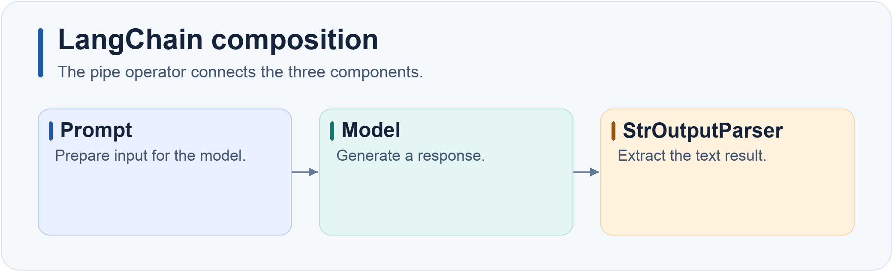

# LangChain for AI Agents

Mô-đun 2 · Oracle Student Guide, trang 55–89 · [Mục lục](README.md)

## Kiến thức mô-đun 2

Guide chia mô-đun thành ba phần. Phần đầu giới thiệu LangChain, models, prompts và chains. Phần tiếp theo xây một agent dùng tools. Phần cuối theo dõi các request và tool results bên trong `agent.invoke()`. (trang 55–56)

### 1. Introduction to LangChain

#### LangChain và ecosystem

LangChain là open-source framework để xây ứng dụng dùng LLM. **Connect** nối model với tools, APIs và databases. **Orchestrate** phối hợp nhiều bước thành workflow. **Build** dùng các thành phần đó để tạo agent, chatbot hoặc ứng dụng RAG. (trang 57–58)

| Thành phần | Vai trò trong guide |
| --- | --- |
| **LangChain** | Core framework với các building blocks như models, chains, prompts, tools và memory. |
| **LangGraph** | Graph-based orchestration. Nodes và edges biểu diễn các bước, nhánh, vòng lặp và cách chuyển state. |
| **LangSmith** | Observability, tracing, testing và debugging. Trace cho thấy các model calls, tool invocations và token usage. |
| **Integrations** | Connectors cho LLM providers, tools và data sources, ví dụ vector database hoặc search API. |

Nguồn bảng, trang 59.

#### Models và unified interface

Guide dùng `init_chat_model()` để khởi tạo model bằng identifier có provider prefix, rồi minh họa đổi từ OpenAI sang Anthropic. Cách gọi model trong application có thể dùng chung interface, nên phần code cần đổi khi chuyển provider ít hơn. Tool calling, context window và reasoning vẫn phụ thuộc model đã chọn. Cấu hình package và credentials theo provider dùng trong lab. (trang 60, 71, 89)

#### Prompt templates và LCEL

- **`PromptTemplate`** tạo prompt text từ template có placeholder. Ví dụ trong guide điền giá trị cho biến `topic`.
- **`ChatPromptTemplate`** hỗ trợ messages theo role. System message định hướng hành vi và giọng điệu, human message mang input của người dùng, AI message biểu diễn output trước đó của model.
- **Few-shot prompt** đưa một số cặp input và output mẫu vào prompt để hướng dẫn cách trả lời. (trang 61)

**LangChain Expression Language (LCEL)** dùng toán tử pipe `|` để chuyển output của bước này thành input của bước tiếp theo. Trong guide, `chain = prompt | model | StrOutputParser()`. Khi gọi `chain.invoke({"topic": "AI agents"})`, template điền biến, model tạo chat response, rồi `StrOutputParser()` lấy phần text thành chuỗi Python. (trang 62)

### 2. Build your first agent using LangChain

#### Agent, tools và ReAct

Slide mô tả **basic LLM call** là flow một lượt từ input qua model đến output. **LangChain agent** dùng model để chọn bước tiếp theo qua nhiều lượt. Nó có thể chọn tool, xem kết quả trong context rồi tiếp tục hoặc trả lời. Tools được minh họa bằng web search, database query, code execution và custom APIs. (trang 63–65)

**ReAct** là Reasoning + Acting. Ở bước **Reason**, model quyết định cần dữ liệu hoặc hành động gì. Ở bước **Act**, agent gọi tool đã chọn hoặc trả lời người dùng. Ở bước **Observe**, agent nhận tool result cho quyết định tiếp theo. Vòng lặp tiếp tục đến khi đạt mục tiêu hoặc chạm giới hạn số lượt. Ví dụ thời tiết Seattle dùng `search_weather`, đọc kết quả minh họa rồi trả lời. (trang 70)

#### Anatomy of an agent tool

| Thành phần Python | Agent dùng như thế nào |
| --- | --- |
| **Decorator `@tool`** | Đăng ký Python function để framework có thể đưa vào danh sách tools. |
| **Type hints**, ví dụ `a: float` | Giúp LangChain tạo input schema, gồm tên và kiểu dữ liệu của arguments. |
| **Docstring** | Cung cấp description để model nhận ra tool phù hợp với tác vụ và biết khi nào dùng. |
| **Return type**, ví dụ `-> float` | Mô tả kiểu kết quả dự kiến, hữu ích khi dùng output của tool này ở bước sau. |
| **Function body** | Chứa logic thực thi do application chạy, ví dụ phép tính, query hoặc API call. |

Model nhận tool definition dưới dạng JSON schema. Ví dụ `add` có tên, description và metadata của hai arguments kiểu số. Description cụ thể giúp model phân biệt phép cộng với các phép toán khác. (trang 66–69)

#### Setup và chạy agent đầu tiên

1. Tạo Python virtual environment. Bài lab cài `langchain`, `langchain-openai`, `langgraph` và `python-dotenv`, rồi cấu hình `OPENAI_API_KEY` trong `.env`. (trang 71)
2. Khởi tạo chat model bằng `init_chat_model()`. Đăng ký `multiply` và `divide` với `@tool`, type hints và docstring. Hàm `divide` kiểm tra trường hợp mẫu số bằng 0. (trang 72)
3. Truyền model và tools cho `create_agent()`. Gọi `agent.invoke()` với danh sách `messages` chứa user message yêu cầu nhân 15 với 8 rồi chia cho 3. (trang 72, 74)
4. Kiểm tra hai bước thực thi. Tool đầu trả 120. Tool sau dùng kết quả này và trả 40.0. Model dùng các kết quả đó để tạo final answer. (trang 79–85)

### 3. LangChain agent under the hood

Luồng điều khiển trong guide đi từ **user → Python code → LangChain → Model API**. Application cung cấp danh sách tools. Model chọn action và arguments, còn LangChain xử lý request, tìm hàm và đưa kết quả trở lại conversation. Bảng dưới theo bài toán nhân rồi chia của guide. (trang 73–88)

| Bước | Request, execution hoặc response | Trang |
| --- | --- | --- |
| 1 | Python gọi `agent.invoke()` với user message. | 74 |
| 2 | LangChain gửi `messages` và `tools` đến Model API. Tool schema có tên, description, parameters và danh sách arguments bắt buộc. | 75 |
| 3 | Model trả assistant message chứa `tool_calls`. Lời gọi đầu là `multiply`, có arguments cho 15 và 8 cùng ID `call_001`. Trong payload minh họa, arguments được mã hóa dưới dạng JSON string. | 76 |
| 4 | LangChain parse response để lấy tên tool, arguments và call ID. | 77 |
| 5 | Tool registry ánh xạ tên `multiply` sang Python function đã đăng ký. | 78 |
| 6 | LangChain chạy `multiply(15, 8)` ở application và nhận 120. | 79 |
| 7 | LangChain thêm message role `tool` chứa 120 và `tool_call_id` trùng `call_001`. Lần gọi model tiếp theo gửi history gồm user message, tool call và tool result, cùng tool definitions. | 80 |
| 8 | Model đọc 120 và yêu cầu `divide(120, 3)` với ID mới `call_002`. | 81 |
| 9 | LangChain thực thi `divide` và nhận 40.0. | 82 |
| 10 | LangChain thêm tool result của `call_002`. History gửi lại lúc này có năm messages, gồm user message và hai cặp tool call–tool result. | 83 |
| 11 | Model trả final answer bằng text. Response này kết thúc tool loop. | 84 |
| 12 | `agent.invoke()` trả result về Python code. Nếu bật trace logging, có thể xem từng tool call và kết quả tương ứng. | 85 |

Bài toán có ba model responses và hai lần thực thi Python tools. Đây là ví dụ **conversation as state**. Model nhận kết quả 120 qua history để chọn arguments cho lời gọi tiếp theo. Các ID giữ đúng mối liên hệ giữa tool call và tool result. (trang 80–84, 87–89)

Hiểu chuỗi bước bên trong `agent.invoke()` giúp tìm lỗi ở schema, arguments, registry, function execution hoặc history. Guide nêu các mục tiêu gồm debugging, xây custom agent loops, tối ưu performance và đưa agent lên production. (trang 85–88)

## What You’ve Learned

Student Guide, trang 89.

1. **LangChain** cung cấp giao diện thống nhất cho nhiều LLM providers.
2. `chain = prompt | model | StrOutputParser()`. Toán tử `|` nối các bước trong chain.
3. **LLM = Reasoning.** Model quyết định gọi tool nào và truyền arguments gì. Việc thực thi thuộc lớp application.
4. **Application = Execution.** LangChain phân tích tool request, chạy hàm Python rồi gửi kết quả về model.
5. **ReAct Loop** chạy theo vòng `Reason → Act → Observe → Repeat` đến khi model không cần gọi thêm tool.
6. **Conversation = State.** Mỗi message được thêm vào history. Trong flow của bài, toàn bộ history được gửi lại trong mỗi LLM API call.
7. **`agent.invoke()`** gói việc chuẩn bị schemas, gọi API, parsing và execution vào một lời gọi.

## Ôn Skill Check mô-đun 2

Số trang dưới đây trỏ tới các phần giải thích và ví dụ trong [Oracle Student Guide](https://mylearn.oracle.com/ou/ekit/163240/163512/66a3c548-2f85-4e05-b3b6-c6327492f4d3/course).

### 1. LangChain gửi gì trong first agent request?

**Phương án 1. LangChain gửi user message và các tool definitions có sẵn.** Trong ví dụ, `agent.invoke()` nhận câu hỏi từ Python code. Request đầu gửi đến Model API có hai trường chính. `messages` chứa câu hỏi với role `user`, còn `tools` chứa danh sách tool model được phép yêu cầu gọi. (trang 74–75)

Mỗi tool definition có tên, description và JSON schema cho parameters, gồm tên, kiểu dữ liệu và các tham số bắt buộc. LangChain dựng schema từ hàm đăng ký bằng `@tool`. Model dùng docstring để chọn tool và dùng type hints để tạo arguments đúng kiểu. (trang 66–67, 75)

### 2. Vì sao cần hiểu LangChain internals?

**Phương án 2. Hiểu internals giúp debug lỗi và tối ưu agent khi đưa vào production.** Guide nêu bốn ứng dụng cụ thể gồm debug agent failures, xây custom agent loops, tối ưu performance và triển khai production. (trang 86)

Guide lần theo những bước ẩn sau `agent.invoke()`, gồm dựng tool schema, gửi request, parse tool call, tra tool registry, chạy hàm Python và thêm tool result vào history. Khi debug, trace cho thấy tool nào được gọi, arguments gì đã được dùng và tool trả về kết quả gì. Docstring và schema vẫn là dữ liệu đầu vào để model chọn tool. (trang 66–67, 85–88)

Các thành phần liên quan trong guide gồm LangGraph để điều phối agent bằng graph và LangSmith để tracing, testing và debugging. (trang 59)

### 3. Unified model interface giúp gì khi đổi provider?

**Phương án 2. Developer có thể đổi model provider với ít thay đổi code.** Guide dùng `init_chat_model()` để minh họa cùng một cách khởi tạo cho model của OpenAI và Anthropic. Phần gọi model trong application có thể tiếp tục dùng interface chung. (trang 60, 89)

Khả năng tool calling, context window và reasoning vẫn khác nhau giữa các model. Setup trong guide cài provider integration tương ứng, ví dụ `langchain-openai` hoặc `langchain-anthropic`. Ví dụ OpenAI cấu hình `OPENAI_API_KEY` cho phần xác thực. (trang 60, 71)

### 4. LCEL dùng để làm gì?

**Phương án 1. LangChain Expression Language (LCEL) dùng toán tử pipe `|` để nối các thành phần của chain.** Trong `chain = prompt | model | StrOutputParser()`, output của mỗi bước trở thành input cho bước tiếp theo. (trang 62, 89)

Khi gọi `chain.invoke()` trong ví dụ của guide, `ChatPromptTemplate` điền giá trị vào placeholder, chat model xử lý prompt, và `StrOutputParser()` lấy phần text thành chuỗi Python. `PromptTemplate` dùng cho text có biến, còn `ChatPromptTemplate` hỗ trợ các role như system, human và AI. (trang 61–62)

### 5. Vì sao model trả tool call khi cần chạy hàm Python?

**Phương án 1. Model đảm nhận reasoning và yêu cầu gọi tool. LangChain thực thi hàm ở phía application.** Model trả structured `tool_calls` gồm tên tool, arguments và call ID. Trong response minh họa, arguments là một JSON string. LangChain parse response, tra tên tool trong registry rồi gọi hàm Python với arguments đã parse. (trang 76–79, 89)

Guide dùng phép tính 15 × 8 ÷ 3 để theo dõi ReAct loop.

| Bước | Điều xảy ra trong ví dụ | Trang |
| --- | --- | --- |
| Tool call đầu | Model yêu cầu gọi `multiply` với 15 và 8. LangChain chạy hàm và nhận 120. | 76–79 |
| Tool result | LangChain thêm message role `tool` với `tool_call_id` khớp lời gọi gốc, rồi gửi lại conversation history. | 80 |
| Tool call tiếp theo | Model dùng 120 từ tool result làm argument để gọi `divide`. LangChain chạy phép chia cho 3 và gửi lại kết quả 40.0. | 81–83 |
| Final answer | Response của model có nội dung text và kết thúc chuỗi tool calls. LangChain trả result về cho Python code. | 84–85 |
