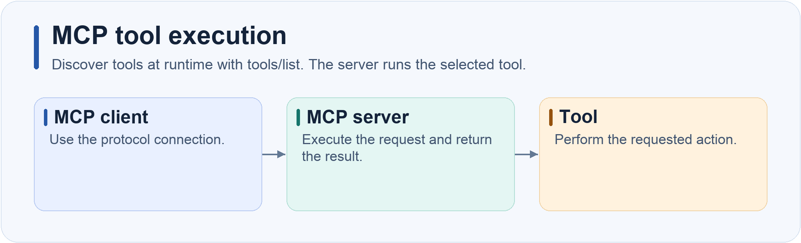

# Introduction to MCP

*Giới thiệu về MCP*

Module 3 · [Student Guide D1114464GC10](https://mylearn.oracle.com/ekit/163240/163512/66a3c548-2f85-4e05-b3b6-c6327492f4d3/course), tr. 91–121 · [Mục lục](README.md)

## Agenda

*Nội dung học*

1. [Model Context Protocol là gì?](#1-what-is-model-context-protocol)
2. [Các thành phần cốt lõi của MCP](#2-mcp-core-components)
3. [Thêm MCP server vào agent đầu tiên](#3-add-mcp-server-to-your-first-agent)
4. [Ví dụ MCP trong thực tế](#4-real-world-mcp-walkthrough)

Nội dung theo chương trình học ở tr. 92 của Student Guide.

[Ôn tập module](#module-review) bao gồm các biến thể của cả năm câu hỏi kiểm tra.

<a name="1-what-is-model-context-protocol"></a>

## 1. Model Context Protocol là gì?

**Model Context Protocol (MCP) là một chuẩn mở để kết nối ứng dụng AI với các tool, nguồn dữ liệu và hệ thống bên ngoài.** Với tool, **MCP chuẩn hóa cách client tìm hiểu server cung cấp những gì và gọi một tool cụ thể**. Một host viết bằng Java có thể gọi MCP server viết bằng Python qua cùng giao thức.

Host vẫn điều phối vòng lặp của agent. Khi xử lý lời gọi tool, server có thể gọi một REST API hiện có, như trong ví dụ OCI bên dưới.

Anthropic giới thiệu MCP vào tháng 11 năm 2024. Dự án thuộc Agentic AI Foundation của Linux Foundation. (tr. 93–94)

### The integration problem

*Bài toán tích hợp*

| Mô hình tích hợp | Số lượng cần triển khai cho N ứng dụng và M dịch vụ | 3 ứng dụng và 4 dịch vụ |
| --- | --- | --- |
| Kết nối theo từng cặp | Tối đa `N × M` adapter, mỗi cặp ứng dụng và dịch vụ dùng một adapter. | 12 adapter |
| Dùng chung giao thức MCP | `N + M` tích hợp giao thức, mỗi ứng dụng hoặc dịch vụ tích hợp một lần. | 7 tích hợp |

**`N + M` là số phần triển khai giao thức.** Host vẫn cần một kết nối client cho mỗi server mà nó sử dụng. (tr. 95–96)

<a name="2-mcp-core-components"></a>

## 2. Các thành phần cốt lõi của MCP

| Vai trò | Trách nhiệm |
| --- | --- |
| **Host** | Chạy ứng dụng AI, điều phối mô hình và quản lý các MCP client. |
| **MCP client** | Trao đổi thông điệp theo giao thức với một server. |
| **MCP server** | Công bố các khả năng được hỗ trợ, **thực thi những tool do nó cung cấp** và trả kết quả. |

Server có thể cung cấp **Tools** để thực hiện hành động, **Resources** cho dữ liệu có địa chỉ URI và **Prompts** cho các mẫu có thể dùng lại. Host quyết định cách cung cấp những khả năng hiện có cho mô hình và người dùng. (tr. 96–98)

<a name="connection-lifecycle"></a>

### Vòng đời kết nối

1. **Khởi tạo.** Client dùng `initialize` để thỏa thuận phiên bản giao thức và trao đổi thông tin về các khả năng được hỗ trợ với server. Sau đó client gửi thông báo đã khởi tạo xong.
2. **Khám phá.** **`tools/list` trả về tên, mô tả và định nghĩa `inputSchema` của các tool.** Resource và prompt có phương thức khám phá riêng.
3. **Vận hành.** **Client dùng `tools/call` để gọi một tool cụ thể theo tên và truyền các đối số.** Server chạy tool rồi trả kết quả.
4. **Kết thúc.** Client đóng kết nối. (tr. 99–102)

Nếu server hỗ trợ đăng ký theo dõi, client có thể dùng `resources/subscribe` để nhận cập nhật của một resource. Khi resource đó thay đổi, server có thể gửi `notifications/resources/updated`.

<a name="tool-input-schema"></a>

### Schema đầu vào của tool

**`inputSchema` là JSON Schema của các đối số mà tool nhận.** Nó mô tả cấu trúc dự kiến, kiểu dữ liệu của các trường, trường bắt buộc và các ràng buộc đã khai báo. Client có thể dùng schema này để tạo yêu cầu gọi tool hợp lệ.

Ví dụ, `get_order` có thể khai báo rằng `order_id` là một chuỗi bắt buộc.

```json
{
  "type": "object",
  "properties": {
    "order_id": {
      "type": "string"
    }
  },
  "required": ["order_id"]
}
```

Sau đó client gửi các giá trị thực tế trong trường `arguments` của tham số `tools/call`.

```json
{
  "name": "get_order",
  "arguments": {
    "order_id": "ORD-42"
  }
}
```

Cấu hình kết nối xác định cơ chế truyền tải và xác thực. Cách triển khai xác định nơi server chạy.

### Messages and transports

*Thông điệp và cơ chế truyền tải*

MCP dùng **JSON-RPC 2.0** để định dạng thông điệp. Một yêu cầu có `method` và có thể có `params`. ID yêu cầu dùng để ghép yêu cầu với phản hồi kết quả hoặc lỗi. Thông báo không có ID. Kết quả tool có thể chứa trường `content`. (tr. 100–102)

| Cơ chế truyền tải | Kênh giao tiếp |
| --- | --- |
| **stdio** | Một tiến trình cục bộ trao đổi thông điệp với client qua đầu vào và đầu ra chuẩn. |
| **Streamable HTTP** | Client gửi yêu cầu HTTP tới một endpoint. Phản hồi có thể dùng Server-Sent Events (SSE). Dịch vụ có thể yêu cầu xác thực HTTP. |

**JSON-RPC định nghĩa cấu trúc thông điệp. Cơ chế truyền tải chuyển các thông điệp đó.** Việc khám phá và gọi tool có cùng mục đích trên cả hai cơ chế truyền tải. (tr. 103)

<a name="3-add-mcp-server-to-your-first-agent"></a>

## 3. Thêm MCP server vào agent đầu tiên

Chuyển một tool cục bộ sang MCP làm thay đổi nơi chạy hàm xử lý của tool. Mô hình có thể đề xuất một lời gọi tool. Host điều phối vòng lặp của agent và MCP client gửi yêu cầu. **MCP server chạy hàm xử lý của tool rồi trả kết quả.** (tr. 104–115)



`FastMCP` có thể cung cấp các hàm đã đăng ký bằng `@mcp.tool()`. **`MultiServerMCPClient` quản lý các kết nối độc lập tới những server đã cấu hình. Phương thức `get_tools()` gộp các tool tìm được thành một danh sách để agent LangChain sử dụng.**

Ví dụ, agent có thể thấy `get_order` từ server Orders và `check_stock` từ server Inventory. Lời gọi `get_order` được gửi đến server Orders. Các server hoạt động độc lập và cung cấp các tool riêng.

Gọi trực tiếp phù hợp với logic cục bộ đơn giản. Giao diện MCP hữu ích khi nhiều ứng dụng dùng chung tool hoặc khi phần triển khai do một dịch vụ khác quản lý. (tr. 107–115, 121)

<a name="4-real-world-mcp-walkthrough"></a>

## 4. Ví dụ MCP trong thực tế

Server có thể nhận yêu cầu MCP qua một cơ chế truyền tải và gọi dịch vụ phía sau qua cơ chế khác. OCI Usage MCP Server minh họa ranh giới này. (tr. 116–120)

**MCP client → stdio → OCI Usage MCP Server → HTTPS → OCI Usage REST API**

MCP server dùng một hồ sơ cấu hình OCI để xác thực yêu cầu gửi tới dịch vụ phía sau. `get_summarized_usage` nhận tenancy, khoảng thời gian, `granularity`, `group_by` và `query_type`. Các trường này thuộc về tool của OCI. Client khám phá và gọi tool qua cùng giao diện MCP dùng cho các tool khác. (tr. 118–121)

<a name="module-review"></a>

## Ôn tập module

### Q1. MCP as a standardized tool execution layer

*Câu 1. MCP là lớp chuẩn hóa cách gọi và thực thi tool*

Xem [Model Context Protocol là gì?](#1-what-is-model-context-protocol).

- **Vì sao MCP được gọi là lớp chuẩn hóa cách gọi và thực thi tool?** MCP cung cấp cho các ứng dụng AI một cách chung để khám phá và gọi tool do các server bên ngoài cung cấp.
- **`N + M` đếm những gì?** Đó là số tích hợp với giao thức chung. Mỗi ứng dụng trong N ứng dụng triển khai phía client. Mỗi dịch vụ trong M dịch vụ triển khai phía server. Khi chạy, host vẫn kết nối tới những server mà nó sử dụng.
- **Ứng dụng Java có thể gọi một MCP tool viết bằng Python không?** Có. Client Java và server Python giao tiếp qua cùng giao thức. Server Python thực thi hàm xử lý tool của nó.
- **REST và MCP có thể xuất hiện trong cùng một workflow như thế nào?** Client của agent dùng MCP để gọi tool. Hàm xử lý tool có thể dùng REST để gọi một dịch vụ hiện có.
- **Vòng lặp của agent thay đổi thế nào sau khi thêm MCP?** Host vẫn điều phối mô hình, các lời gọi tool và kết quả. MCP cung cấp giao diện để gọi các server tool bên ngoài.

### Q2. Tool discovery and invocation

*Câu 2. Khám phá và gọi tool*

Xem [Vòng đời kết nối](#connection-lifecycle).

- **`tools/call` làm gì?** Nó yêu cầu thực thi một tool theo tên và truyền đối số cho lần gọi đó.
- **Phương thức nào cho biết có những tool và đối số nào?** `tools/list` trả về các định nghĩa tool, bao gồm `inputSchema` của chúng.
- **Khi nào phiên bản giao thức được thỏa thuận?** Trong bước `initialize`, trước khi bắt đầu khám phá hoặc gọi tool.
- **Client làm sao biết một resource đã thay đổi?** Nếu server hỗ trợ đăng ký theo dõi, client có thể dùng `resources/subscribe` và nhận `notifications/resources/updated` khi resource thay đổi.

### Q3. Understanding `inputSchema`

*Câu 3. Hiểu `inputSchema`*

Xem [Schema đầu vào của tool](#tool-input-schema).

- **`inputSchema` mô tả điều gì?** Cấu trúc và kiểu dữ liệu dự kiến của các đối số, gồm các trường bắt buộc và những ràng buộc khác đã khai báo.
- **Làm sao biết `order_id` có bắt buộc hay không?** Kiểm tra trường này có xuất hiện trong `required` hay không. Khai báo nó là chuỗi trong `properties` xác định kiểu dữ liệu của nó.
- **`inputSchema` và `arguments` khác nhau thế nào?** Schema định nghĩa đầu vào dự kiến. `arguments` chứa các giá trị thực tế của một lần gọi cụ thể, chẳng hạn `{"order_id":"ORD-42"}`.
- **Xác thực, cơ chế truyền tải và vị trí của tool được xác định ở đâu?** Cấu hình kết nối xác định xác thực và cơ chế truyền tải. Cách triển khai xác định vị trí của tool.

### Q4. Who does what in a tool call?

*Câu 4. Mỗi thành phần làm gì khi gọi tool?*

Xem [Các thành phần cốt lõi của MCP](#2-mcp-core-components) và [Thêm MCP server vào agent đầu tiên](#3-add-mcp-server-to-your-first-agent).

- **Thành phần nào chạy phần triển khai thực tế của tool?** MCP server thực thi hàm xử lý tool và trả kết quả.
- **Từng thành phần có vai trò gì trong lời gọi?** Mô hình có thể đề xuất lời gọi. Host điều phối. MCP client gửi yêu cầu. MCP server thực thi hàm xử lý.
- **JSON-RPC và Streamable HTTP khác nhau thế nào?** JSON-RPC định dạng thông điệp. Streamable HTTP là một cách truyền các thông điệp đó. MCP client và server cũng có thể trao đổi thông điệp qua stdio.
- **Thành phần nào gọi API của dịch vụ phía sau?** Hàm xử lý ở phía server có thể gọi API đó khi chạy tool. Trong ví dụ OCI, MCP server gửi yêu cầu tới OCI Usage REST API.

### Q5. One agent, multiple MCP servers

*Câu 5. Một agent dùng nhiều MCP server*

Xem [Thêm MCP server vào agent đầu tiên](#3-add-mcp-server-to-your-first-agent).

- **Vì sao một agent có thể dùng tool từ nhiều server?** `MultiServerMCPClient` quản lý các kết nối độc lập tới những server đã cấu hình và cung cấp các tool tìm được qua `get_tools()`.
- **Sau khi gộp các danh sách, lời gọi tool được gửi đi đâu?** Lời gọi được chuyển đến server đã công bố tool được chọn. `get_order` được gửi đến server Orders, còn `check_stock` được gửi đến server Inventory.
- **Các server có phải dùng chung tiến trình hoặc tên tool không?** Mỗi server có thể chạy độc lập và cung cấp các tool riêng. Adapter gộp các định nghĩa tool cho agent sử dụng.
- **`MultiServerMCPClient` có thuộc đặc tả MCP không?** Đây là một adapter của LangChain. Mỗi tương tác giữa client và server bên dưới vẫn dùng MCP.
