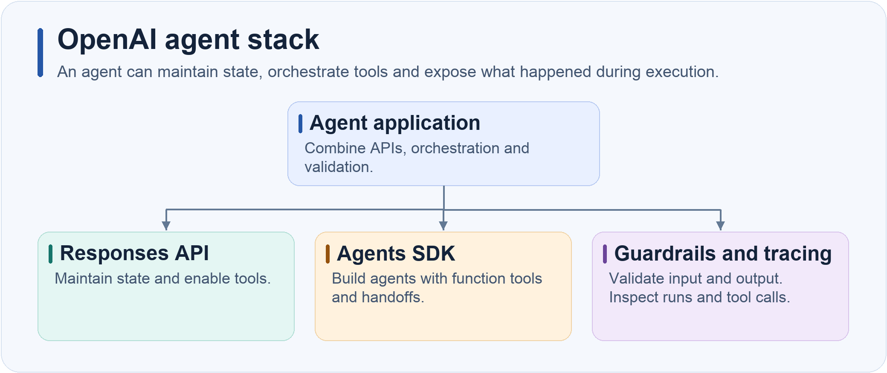

# OpenAI Responses API and Agents SDK

Module 4 · [Student Guide D1114464GC10](https://mylearn.oracle.com/ekit/163240/163512/66a3c548-2f85-4e05-b3b6-c6327492f4d3/course), pp. 123–162 · [Index](README.md)

## Agenda

1. [OpenAI Agent Stack](#1-openai-agent-stack)
2. [OpenAI Responses API](#2-openai-responses-api)
3. [OpenAI Agents SDK](#3-openai-agents-sdk)
4. [Tools and Function Calling](#4-tools-and-function-calling)
5. [Multi-Agent Systems with Handoffs](#5-multi-agent-systems-with-handoffs)
6. [Guardrails and Safety](#6-guardrails-and-safety)
7. [Putting it all together](#7-putting-it-all-together)

Student Guide agenda, p. 124.

## 1. OpenAI Agent Stack

The **OpenAI agent stack** separates the application, the runtime, and the model API. The application owns business rules and permissions. The **Responses API** sends inputs to a model and returns structured output. The **Agents SDK** coordinates multi-step agent runs on top of the API. (pp. 125–129)

| Interface | Who controls the next step? |
| --- | --- |
| **Responses API directly** | Application code interprets responses and decides which calls to make next. |
| **Agents SDK** | The configured runner manages the loop, including tool execution and handoffs. |

## 2. OpenAI Responses API

`client.responses.create()` takes a model and text or structured input. The response contains **output items** for structured processing. `response.output_text` exposes the text for display. (pp. 130–132)

**Conversation chaining** uses `previous_response_id` to connect a new turn to the context of an earlier response. Available built-in tools can include Web Search, File Search, Code Interpreter, Computer Use, and Image Generation. The application declares the available tools, and the model decides when to use them. (pp. 133–135)

## 3. OpenAI Agents SDK

`Agent` holds instructions, a model, and tools. The **Runner** sends input to the model, executes requested tools, and feeds their results back. It repeats the loop until the run reaches a final output. (pp. 136–141)

`Runner.run_sync()` runs synchronously. `Runner.run()` is asynchronous. The completed run exposes its final result as `result.final_output`. (pp. 138–141)

## 4. Tools and Function Calling

| Tool type | Who does the work? |
| --- | --- |
| **Hosted Tools** | The platform provides and executes a capability such as Web Search or Code Interpreter. |
| **Function Tools** | The application's Python function runs. `@function_tool` exposes its schema using metadata such as type hints and the docstring. |
| **Agents as Tools** | `as_tool()` exposes a specialist agent. Its result returns to the agent that called it. |

The runner returns intermediate tool results to the model so later calls can depend on them. The application function retains its own validation and business logic. (pp. 142–148) [Tool execution in LangChain](02-langchain-for-ai-agents.md#3-langchain-agent-under-the-hood)

## 5. Multi-Agent Systems with Handoffs

**Triage** routes a request to a suitable specialist. The orchestration pattern determines who controls the run after routing. (pp. 149–152)

| Pattern | Who owns the rest of the run? |
| --- | --- |
| **Handoff** | The specialist takes control. `handoff_description` describes when to route to it, and `handoffs` lists available targets. |
| **Manager pattern** | The manager keeps control, calls specialists through `as_tool()`, and combines their results. |

## 6. Guardrails and Safety

**Input guardrails** validate a request. A blocking check finishes before the agent starts. A concurrent check can overlap with agent work, which reduces waiting time and allows work to start before the result is known. **Output guardrails** check the final result. (pp. 153–154)

An `@input_guardrail` can return `GuardrailFunctionOutput` with `tripwire_triggered` set to stop the run. Pydantic can represent the structured result of a checker agent. **Tracing** records model calls, tool arguments, handoffs, guardrail outcomes, time, and token usage. A **span** represents an individual operation in the trace. (pp. 155–156)

## 7. Putting it all together

A customer support system combines an input guardrail, a triage agent, and specialists for order status, refunds, or frequently asked questions. The guardrail checks scope. Triage selects the specialist. The specialist calls the appropriate function or search tool and uses the result in its answer. (pp. 157–162)

A trace connects the routing decision to the selected tool and the final answer. It also shows whether latency came from a model call, a guardrail, or the function itself. (pp. 159–161)
