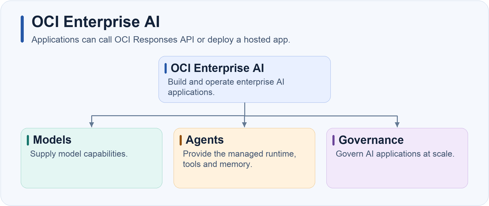

# Agentic AI for Enterprises

Student Guide · What You’ve Learned · trang 195 · [Mục lục](README.md)

1. **Runtime Architecture** đưa agent vào môi trường vận hành thực tế.
2. **OCI Enterprise AI** kết hợp Models, Agents và Governance để vận hành ứng dụng AI ở quy mô doanh nghiệp.
3. **OCI Enterprise AI Agents** cung cấp managed agent runtime.
4. **Agent capabilities** gồm OCI Responses API, Tools, Memory và Lower-level APIs.
5. **OpenAI-compatible interface** nhận request theo cú pháp OpenAI và thực thi trên OCI Enterprise AI.
6. **Deployment.** Xây agent bằng OCI Responses API hoặc triển khai hosted application trên OCI.

