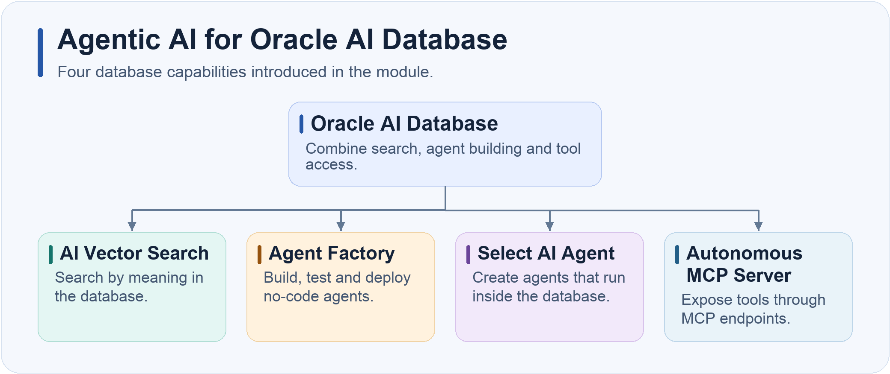

# Agentic AI for Oracle AI Database

Module 6 · [Student Guide D1114464GC10](https://mylearn.oracle.com/ekit/163240/163512/66a3c548-2f85-4e05-b3b6-c6327492f4d3/course), trang 197–241 · [Mục lục](README.md)

Module này trình bày cách tìm dữ liệu theo ngữ nghĩa trong Oracle AI Database, xây agent bằng giao diện no-code, chạy agent workflow trong database và expose tools qua MCP. Sơ đồ tổng quan của Guide cũng giới thiệu Autonomous AI Vector Database trong nhóm khả năng dành cho vector workloads. (trang 197–200)

## Embeddings và Oracle AI Vector Search

Keyword search tìm những từ xuất hiện trong dữ liệu. **Semantic search** dùng embedding để tìm nội dung gần nghĩa với query. Một embedding là vector số do model tạo. Với văn bản, tokenizer chia input thành tokens, kể cả subword tokens, rồi model xử lý chúng để tạo vector có số chiều xác định. Document embeddings và query embedding cần cùng embedding space để so khoảng cách có ý nghĩa. (trang 201–204)

**Oracle AI Vector Search** lưu vector cạnh business data và truy vấn bằng SQL. Một request có thể xếp hạng theo semantic similarity đồng thời lọc theo giá, danh mục hoặc metadata khác. (trang 205)

## Vector Search workflow

1. **Generate embeddings.** Guide minh họa ONNX model trong database qua `DBMS_VECTOR.LOAD_ONNX_MODEL` và `VECTOR_EMBEDDING`, cùng hướng dùng external embedding provider. (trang 206–208)
2. **Chunk và lưu dữ liệu.** Tài liệu dài được tách để phù hợp giới hạn input của model và để retrieval trả về đoạn liên quan. Pipeline có thể dùng `UTL_TO_TEXT → UTL_TO_CHUNKS → UTL_TO_EMBEDDINGS`. Lưu chunk, document ID, vector và metadata cùng nhau. (trang 207–210)
3. **Tạo index.** Guide giới thiệu HNSW và IVF cho vector search, cùng hybrid vector indexes để kết hợp các kiểu tìm kiếm. (trang 207)
4. **Search và dùng kết quả.** Tạo query embedding, so khoảng cách bằng `VECTOR_DISTANCE`, lấy top-k, và dùng kết quả làm context cho RAG nếu workflow cần. (trang 207, 211)

Kiểu `VECTOR` có thể khai báo số chiều và format, ví dụ `VECTOR(384, FLOAT32)`. Guide đề cập `FLOAT32`, `FLOAT64`, `INT8` và `BINARY`, cùng dense và sparse vectors. Dense representation lưu đầy đủ phần tử, còn sparse representation lưu vị trí và giá trị của các phần tử khác 0. (trang 210)

| Metric | Giá trị biểu diễn |
| --- | --- |
| **Cosine** | Độ khác nhau về hướng của vectors. |
| **Euclidean (L2)** | Khoảng cách đường thẳng giữa hai vectors. |
| **Manhattan (L1)** | Tổng chênh lệch tuyệt đối trên từng chiều. |
| **Dot Product** | Điểm phụ thuộc vào cả hướng và độ lớn của vectors. |

Với distance metrics, kết quả gần hơn có distance nhỏ hơn. Hướng xếp hạng của inner product cần phù hợp với cách dùng score. Guide minh họa xếp hạng top-k bằng `VECTOR_DISTANCE` với cosine. (trang 211)

## Oracle AI Vector Search Demo

Bài lab dùng `python-oracledb`, `SentenceTransformer` với `all-MiniLM-L6-v2` và một catalog mười sản phẩm. Trong setup, bảng chứa tên, mô tả, giá, danh mục và embedding 384 chiều. Ingestion tạo embedding cho từng mô tả và bind vector float32 khi insert. Query text cũng được encode bằng cùng model. (trang 212–216)

| Truy vấn | Cách xử lý |
| --- | --- |
| Tìm dụng cụ tập luyện ở nhà | So cosine distance với các hàng trong catalog rồi lấy top 3. Slide minh họa đưa ra Yoga Mat, Fitness Tracker và Basketball. |
| Tìm đồ bảo hộ cho water sports dưới 100 USD | Lọc bằng `WHERE price < 100`, xếp hạng những hàng còn lại theo cosine distance rồi lấy top 5. |

Ví dụ đầu minh họa exact similarity search. Ví dụ sau kết hợp vector ranking và điều kiện quan hệ trong cùng SQL query. (trang 217–222) [Lab Vector Search và kết quả mẫu](../labs/README.md#vector-search-comparison-with-the-guide)

## Oracle AI Database Private Agent Factory

**Private Agent Factory** cung cấp pre-built agents, visual builder, kết nối enterprise data và các kiểm soát như SSO, role-based access và prompt guardrails. Guide mô tả application chạy dạng container với Podman, có thể deploy on-premises hoặc trên cloud khi kết nối được đến Oracle AI Database và model provider cần dùng. (trang 223–225)

- **Knowledge Agent** kết nối nguồn như file, SharePoint, websites hoặc OCI Object Storage. Tài liệu được vectorize để phục vụ truy xuất theo ngữ nghĩa. Câu trả lời có thể dẫn tới nội dung nguồn. (trang 226)
- **Data Analysis Agent** hiểu tables và views mà nó được phép dùng, tạo và chạy SQL từ câu hỏi tự nhiên, rồi trình bày dữ liệu hoặc visualization. Guide cũng minh họa follow-up questions dựa trên dữ liệu. (trang 227)
- **Agent Builder** ghép nodes trong visual workflow. Có thể thêm tools, MCP integrations, Python custom components và multi-agent orchestration. (trang 228)

## Oracle Select AI Agent Framework

Select AI Agent đặt agent workflow gần database data. AI profile cung cấp cấu hình model và context. `DBMS_CLOUD_AI_AGENT` dùng để định nghĩa các thành phần như agents, tools, tasks và teams. Quyền dữ liệu, role-based access, Virtual Private Database (VPD) và audit có thể được áp dụng ở lớp database. (trang 229–231)

Workflow gồm **Planning** để chọn các bước, **Tool Use** để chạy hành động, **Reflection** để kiểm tra kết quả và điều chỉnh kế hoạch, và **Memory Management** để giữ context qua các lượt. Tools trong Guide gồm built-in RAG và NL2SQL, custom PL/SQL functions, và external REST integrations. (trang 232–233)

Trong **Customer Return Agent**, NL2SQL tìm đơn 5821 và lấy dữ kiện để kiểm tra return window 30 ngày. Sau khi đơn đủ điều kiện, custom PL/SQL tool cập nhật trạng thái. Agent đọc kết quả cập nhật trước khi xác nhận với người dùng. (trang 234) [Kết quả lab mô phỏng](../labs/sample-results/customer-return-local.json)

## Autonomous AI Database MCP Server

Guide mô tả **Autonomous AI Database MCP Server** là tính năng managed, multi-tenant, tích hợp trong Autonomous AI Database Serverless. MCP client đi qua HTTPS với Streamable HTTP tới endpoint ứng với region và database OCID. Server expose Select AI Agent tools, ví dụ NL2SQL, RAG và custom PL/SQL. (trang 235–236, 239–240)

Database credentials xác định caller. Database roles và policies chi phối tool access và dữ liệu được trả về. Với NL2SQL, AI profile có schema metadata để giảm việc khám phá schema trong mỗi lượt. Flow này đưa vector search, database agents và MCP tools vào cùng kiến trúc dữ liệu. (trang 237–241)
